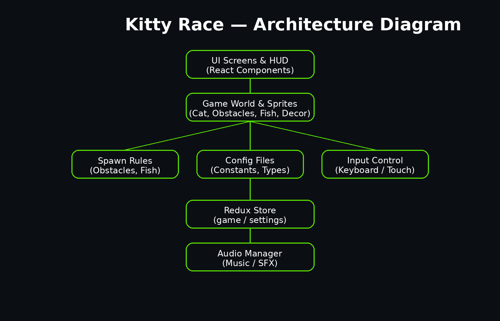

# Kitty Race — подробная документация проекта

Этот документ — **внутренний справочник по коду** Kitty Race: что где лежит, какие файлы за что отвечают,
какой у проекта поток данных, и куда идти, когда нужно что-то изменить.

> Важно: документация описывает **текущую структуру проекта** (по репозиторию/архиву), а не абстрактный шаблон.

---

## 1) Как устроена игра в целом (в двух словах)

- UI и экраны игры — **React-компоненты**.
- Состояние игры (полоса, действие, статус, счёт и т.д.) — **Redux Toolkit**.
- Визуальные слои мира (препятствия/рыба/декор) — отдельные React-слои, которые живут внутри `GameScreen`.
- “Мир едет сверху вниз” за счёт единого значения **скорости мира** и сдвига (**world offset**) в слоях.
- Управление — **keyboard + touch gestures** (свайпы на мобилке).
- Звук — централизованно через `audioManager`.

---

## 2) Структура репозитория (верхний уровень)

```
.
├── index.html
├── package.json
├── vite.config.js
├── tailwind.config.js
├── postcss.config.js
├── eslint.config.js
├── public/
└── src/
```

### Что важно на верхнем уровне
- **Vite**: сборка/девсервер (`vite.config.js`).
- **Tailwind**: токены/брейкпоинты/утилиты (`tailwind.config.js`).
- **index.html**: корневой HTML (Vite mount-point).
- **public/**: статические файлы (если есть).

---

## 3) Структура `src/`

```
src/
├── App.jsx
├── main.jsx
├── index.css
├── app/
│   └── store.js
├── assets/
│   ├── background.png
│   ├── environment/
│   │   ├── fish.png
│   │   ├── left_road.png
│   │   ├── obstacles/
│   │   └── decor/
│   ├── sound/
│   └── sprites/
├── audio/
│   ├── SoundGate.jsx
│   └── audioManager.js
├── config/
│   ├── catSprite.js
│   ├── playerMotion.js
│   ├── playerRender.js
│   └── trackRoad.js
├── features/
│   ├── game/
│   │   ├── cats.js
│   │   └── gameSlice.js
│   └── settings/
│       └── settingsSlice.js
├── game/
│   └── GameRoot.jsx
└── components/
    ├── screens/
    │   ├── MainMenu.jsx
    │   ├── GameScreen.jsx
    │   ├── PauseMenu.jsx
    │   ├── GameOverMenu.jsx
    │   ├── CatCarouselCard.jsx
    │   └── gameScreen/
    │       ├── GameHud.jsx
    │       ├── PlayerActor.jsx
    │       ├── useGameControls.js
    │       ├── useSquareFieldSize.js
    │       ├── useWorldScrollSpeed.js
    │       └── useWorldSnapshot.js
    └── game/
        ├── CatSprite.jsx
        ├── TrackRoad.jsx
        ├── TrackShoulders.jsx
        ├── dev/
        │   └── invariants.js
        ├── obstacles/
        │   ├── ObstacleLayer.jsx
        │   ├── ObstacleSprite.jsx
        │   ├── obstacleBounds.js
        │   ├── obstacles.config.js
        │   ├── obstacles.spawnRules.js
        │   └── obstacles.utils.js
        ├── pickups/
        │   ├── FishLayer.jsx
        │   ├── FishSprite.jsx
        │   ├── fish.config.js
        │   ├── fish.spawnRules.js
        │   └── fish.utils.js
        └── roadsideDecor/
            ├── RoadsideDecorLayer.jsx
            ├── DecorSprite.jsx
            ├── roadsideDecor.config.js
            └── roadsideDecor.utils.js
```

---

## 4) Точка входа и корневой рендер

### `src/main.jsx`
**Задача:** подключить React-приложение и провайдеры (Redux), примонтировать в DOM.

Обычно здесь:
- `ReactDOM.createRoot(...)`
- `<Provider store={store}>`
- `<App />`

### `src/App.jsx`
**Задача:** верхний компонент приложения.
Как правило, просто рендерит корневую “игру” (у вас это `GameRoot`).

---

## 5) Redux: где хранится состояние игры

### `src/app/store.js`
**Задача:** создать Redux store и подключить reducers:
- `game` (основной state игры)
- `settings` (настройки, звук и т.п.)

### `src/features/game/gameSlice.js`
**Задача:** центральная логика состояния игры:
- статус экрана: `menu / playing / paused / gameover`
- текущая полоса (`laneIndex`)
- текущее действие кота (`actionState`: idle/jump/slide и т.д.)
- счёт/рыба/прочие параметры забега
- экшены: старт, пауза, продолжить, game over, сбор рыбы, триггеры столкновений и т.п.

> Если нужно найти, **где включается game over**, или **где меняется полоса** — начинать отсюда.

### `src/features/game/cats.js`
**Задача:** данные по котам (идентификаторы, цены/доступность, превью и т.п.)

### `src/features/settings/settingsSlice.js`
**Задача:** настройки пользователя, прежде всего звук:
- включён/выключен
- громкость/уровни (если есть)
- любые UI-настройки

---

## 6) Корневой компонент игры и переключение экранов

### `src/game/GameRoot.jsx`
**Задача:** один корневой компонент, который показывает:
- `MainMenu` когда `status === "menu"`
- `GameScreen` когда игра идёт / пауза (важно: экран игры не размонтируется на паузе)
- `PauseMenu` поверх
- `GameOverMenu` поверх

**Почему это важно:** в комментариях к файлу прямо отмечено:
> `GameScreen` не должен размонтироваться на paused/gameover, иначе refs в слоях обнулятся и игра начнётся заново.

То есть:
- `GameScreen` живёт “сквозь” паузу и завершение
- поверх показываются модалки/меню

---

## 7) Экраны (`components/screens`)

### `MainMenu.jsx`
**Задача:** главное меню:
- выбор кота (карточки)
- кнопки старта/настроек
- визуальные элементы UI

Состояние берёт из Redux (выбранный кот, доступность и т.п.)

### `CatCarouselCard.jsx`
**Задача:** карточка кота в меню:
- превью/имя
- цена/статус (куплен/не куплен)
- кнопки действия (если есть)

### `GameScreen.jsx`
**Задача:** центральный игровой экран.
Собирает:
- поле/контейнер игры (квадратное поле под разные экраны)
- дорогу и “плечи” дороги
- слои: препятствия, рыба, декор
- игрока (кот)
- HUD (очки/рыба/кнопки)
- хуки:
  - `useSquareFieldSize`
  - `useGameControls`
  - `useWorldScrollSpeed`
  - `useWorldSnapshot`

**Ключевая идея:** GameScreen задаёт “скелет” сцены, но не хранит сложные правила спавна — это в слоях.

### `PauseMenu.jsx`
**Задача:** меню паузы (оверлей).

### `GameOverMenu.jsx`
**Задача:** экран завершения забега (оверлей).

---

## 8) Подмодули GameScreen (`components/screens/gameScreen`)

### `useSquareFieldSize.js`
**Задача:** вычислить размеры игрового поля так, чтобы:
- поле оставалось квадратным
- корректно влезало на разные экраны
- учитывались отступы под UI

### `useWorldScrollSpeed.js`
**Задача:** единая скорость движения мира (px/sec).
Это “базовая величина”, от которой пляшет смещение слоёв.

### `useWorldSnapshot.js`
**Задача:** подготовка “снимка” текущего состояния мира для слоёв
(часто это совокупность: worldOffset, speed, dt, runId и т.п.)

### `useGameControls.js`
**Задача:** управление:
- keyboard (WASD / стрелки)
- touch gestures (свайпы)
- отправка экшенов в Redux (смена полосы, jump/slide, pause)

> Если на мобилке “не реагирует свайп” — смотреть сюда.

### `PlayerActor.jsx`
**Задача:** актёр игрока (связка Redux-состояния и CatSprite):
- выбирает какой кот
- какое действие (idle/jump/slide)
- куда ставить по полосе

### `GameHud.jsx`
**Задача:** HUD поверх поля:
- счёт / рыба
- UI-кнопки (пауза, звук и т.п.)

---

## 9) Игровые “кирпичики” (`components/game`)

### `TrackRoad.jsx`
**Задача:** отрисовка дороги (фон/полоса дороги), привязка к размерам поля.

### `TrackShoulders.jsx`
**Задача:** боковые “плечи” дороги (обочина), часто используется под декорации.

### `CatSprite.jsx`
**Задача:** чистый визуальный спрайт кота:
- рисует нужный кадр/анимацию из спрайт-листа
- применяет scale/позиционирование
- **не решает**, когда прыгать — только рисует то, что сказали сверху

---

## 10) Препятствия (`components/game/obstacles`)

### `obstacles.config.js`
**Задача:** декларативное описание типов препятствий:
- тип (`jump/slide/sidestep`)
- спрайт
- базовые размеры
- доп. параметры рендера

### `ObstacleSprite.jsx`
**Задача:** отрисовка одного препятствия (img/div + позиционирование).

### `ObstacleLayer.jsx`
**Задача:** слой препятствий:
- хранит список текущих препятствий (обычно в `useRef`, чтобы не триггерить лишние ререндеры)
- двигает препятствия относительно worldOffset
- удаляет ушедшие за экран
- вызывает spawn rules для генерации новых
- проверяет столкновения (или делегирует)

### `obstacles.spawnRules.js`
**Задача:** правила генерации:
- минимальные расстояния
- запреты конфликтов
- логика “какой тип когда можно”

### `obstacles.utils.js`
**Задача:** утилиты генерации:
- random/weighted pick
- нормализация id
- генерация объектов препятствий

### `obstacleBounds.js`
**Задача:** геометрия/границы препятствия (bounds/hitbox):
- расчёт прямоугольника коллизии
- вспомогательные проверки

---

## 11) Рыба (`components/game/pickups`)

### `fish.config.js`
**Задача:** параметры рыбы:
- спрайт
- размеры/позиционирование
- вероятности (если есть)

### `FishSprite.jsx`
**Задача:** отрисовка одной рыбы.

### `FishLayer.jsx`
**Задача:** слой рыбы:
- хранит текущие рыбы
- спавнит по правилам
- двигает относительно worldOffset
- проверяет сбор (пересечение с игроком)
- диспатчит событие “рыба собрана” (Redux)

### `fish.spawnRules.js`
**Задача:** правила спавна рыбы, в том числе конфликты с препятствиями.

### `fish.utils.js`
**Задача:** утилиты генерации объектов рыбы.

---

## 12) Декорации (`components/game/roadsideDecor`)

### `roadsideDecor.config.js`
**Задача:** типы декора:
- спрайт
- базовые размеры
- z-index/слой

### `DecorSprite.jsx`
**Задача:** отрисовка одного декоративного элемента.

### `RoadsideDecorLayer.jsx`
**Задача:** слой декора:
- генерирует элементы по краям дороги
- двигает их вместе с миром
- не участвует в коллизиях

### `roadsideDecor.utils.js`
**Задача:** утилиты генерации и позиционирования декора.

> Если “пропали декорации” — обычно проблема в рендере/transform/z-index именно этих компонентов.

---

## 13) Dev-инструменты (`components/game/dev`)

### `dev/invariants.js`
**Задача:** проверки/инварианты, которые помогают ловить ошибки:
- корректность spacing
- корректность типов
- запрет невозможных состояний

---

## 14) Конфиги (`src/config`)

### `trackRoad.js`
**Задача:** параметры дороги:
- ширина дороги в процентах
- ширина “плеч”/обочины
- дополнительные константы, связанные с трассой

### `playerMotion.js`
**Задача:** параметры движения/длительности действий:
- длительность прыжка/слайда
- окна уязвимости/коллизий (если есть)

### `playerRender.js`
**Задача:** параметры визуала игрока (размеры, отступы, кадры, scale базовый).

### `catSprite.js`
**Задача:** параметры спрайт-листа кота:
- размер кадра
- количество кадров
- соответствие анимаций

---

## 15) Стили и адаптив

### `src/index.css`
Глобальные стили:
- pixelated rendering
- базовые переменные
- адаптивные переменные (tablet/mobile render-scale)

**Ключевая идея адаптива:**
- на десктопе визуал не трогаем
- на tablet/mobile уменьшаем только рендер (через CSS-переменные), не меняя логику

---

## 16) Аудиосистема

### `audio/audioManager.js`
Единый менеджер:
- `playSfx(...)`, `playMusic(...)` (или аналоги)
- кеширование
- громкость
- mute

### `audio/SoundGate.jsx`
Компонент-«шлюз», который:
- подписывается на настройки звука в Redux
- включает/выключает воспроизведение

---

## 17) Потоки данных (как “бежит” информация)

### 17.1 Управление
1) Пользователь нажимает кнопку / делает свайп  
2) `useGameControls` переводит это в экшен Redux  
3) `gameSlice` обновляет `laneIndex` / `actionState`  
4) `PlayerActor` и игровые слои читают новое состояние и рисуют/реагируют

### 17.2 Движение мира
1) `useWorldScrollSpeed` задаёт скорость  
2) `useWorldSnapshot` формирует значения для слоёв  
3) Слои (`ObstacleLayer`, `FishLayer`, `RoadsideDecorLayer`) сдвигают объекты по Y  
4) Объекты уходят вниз — удаляются, сверху — спавнятся новые

### 17.3 Столкновения и сбор
- препятствия → при пересечении с игроком диспатчится `tryGameOver`/аналог
- рыба → при пересечении диспатчится `collectFish`/аналог, игра продолжает

---

## 18) Где что править (шпаргалка)

### Добавить новый тип препятствия
1) `components/game/obstacles/obstacles.config.js` — описать тип/спрайт/размер  
2) `components/game/obstacles/obstacles.spawnRules.js` — добавить правила спавна  
3) (если нужно) `obstacleBounds.js` — уточнить хитбокс

### Изменить частоту/логику спавна рыбы
- `components/game/pickups/fish.spawnRules.js`

### Изменить управление
- `components/screens/gameScreen/useGameControls.js`

### Изменить HUD
- `components/screens/gameScreen/GameHud.jsx`

### Править визуал и адаптив (без геймплея)
- `index.css` + render-only масштабы в Sprite-компонентах

---

## 19) Приложения

### Архитектурная картинка



---

## 20) Итог

Проект организован модульно:
- UI и экраны — `components/screens`
- игровой мир — `components/game`
- правила генерации — `*spawnRules.js`
- конфиги — `src/config`
- состояние — `src/features`
- звук — `src/audio`

Это обеспечивает предсказуемость изменений и снижает риск регрессий в геймплее.
